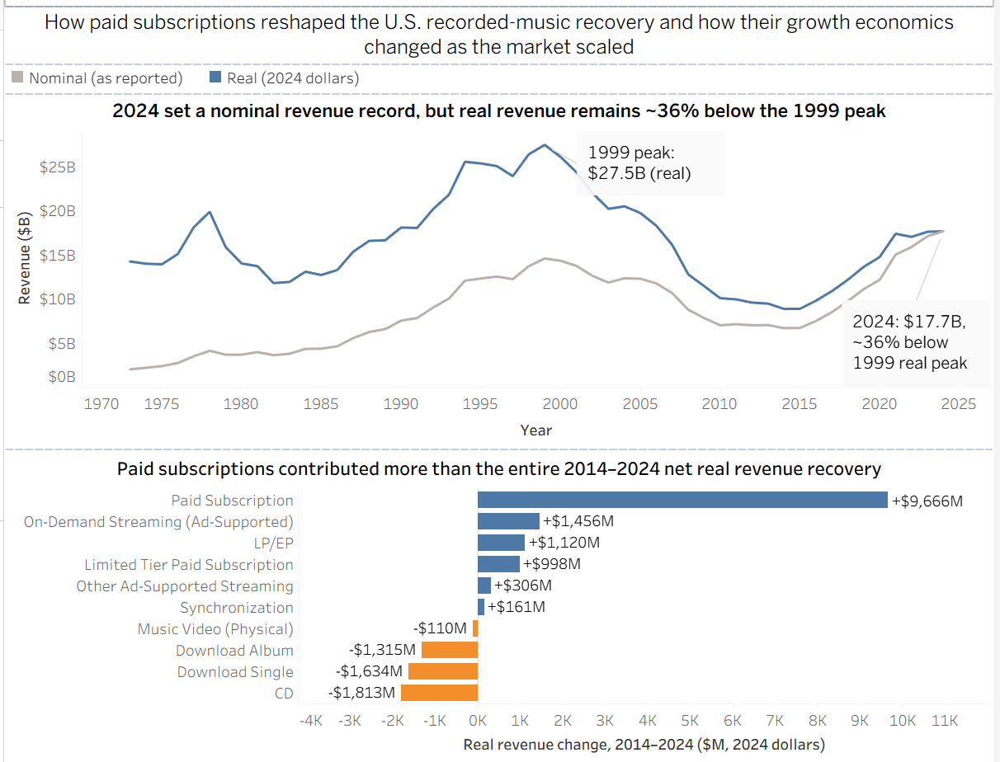
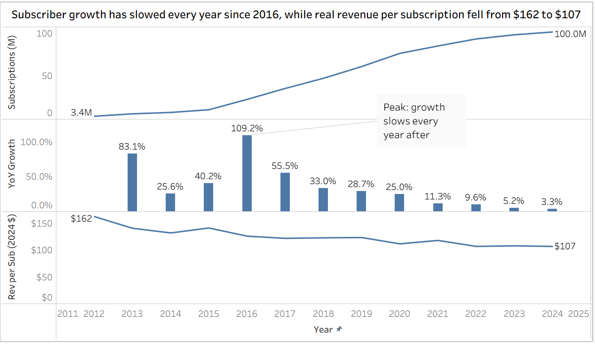

# U.S. Recorded Music Revenue Analysis (1973–2024)

### Exploring the Economics Behind Music Revenue Recovery

An independent analysis of U.S. recorded music industry revenue using Recording Industry Association of America (RIAA) data and Tableau. This project examines long-term revenue trends, the transition from physical to digital formats, and the role of paid subscriptions in the industry's recovery.

**[View Interactive Tableau Dashboard](https://public.tableau.com/app/profile/nirjala.prajapati1612/viz/EconomicsBehindMusicRevenueRecovery/RIAADashboard)**

## Dashboard Preview

## Project Objectives

- Examine how U.S. recorded music revenue has evolved from 1973 to 2024
- Compare nominal and inflation-adjusted revenue to assess long-term industry performance
- Identify which music formats contributed most to the recovery
- Explore subscriber growth and revenue per reported paid subscription

## Tools and Skills

- **Tableau:** Interactive dashboards, calculated fields, filters, and trend visualizations
- **Data Validation:** Metric verification, unit consistency, and reconciliation with published totals
- **Exploratory Data Analysis:** Time-series comparisons and format-level revenue analysis
- **Business Analysis:** Interpretation of industry trends and subscription economics

## Key Findings

### 1. Revenue Has Not Fully Recovered in Real Terms
U.S. recorded music revenue reached approximately **$17.7 billion in 2024**, but remained **35.6% below its 1999 inflation-adjusted peak** of approximately $27.5 billion.

### 2. Paid Subscriptions Drove the Recovery
Inflation-adjusted industry revenue increased from approximately **$8.9 billion in 2014 to $17.7 billion in 2024**, a net increase of $8.8 billion. Paid subscription revenue alone grew by approximately **$9.7 billion**, offsetting declines in other formats.

### 3. Subscriber Growth Has Slowed
Annual-average paid subscriptions reached approximately **100 million in 2024**, while year-over-year subscriber growth slowed to approximately **3.3%**.

### 4. Inflation Matters for Subscription Economics
From 2014 to 2024, nominal revenue per reported subscription increased from approximately **$100 to $107**, while inflation-adjusted revenue per reported subscription declined from approximately **$132 to $107**. This distinction highlights the importance of separating nominal performance from purchasing-power-adjusted trends.

## Data Validation and Methodology

- Analyzed **3,484 RIAA dataset records** covering 1973–2024
- Distinguished subscription counts from subscription revenue to avoid mixing units
- Reconciled 2024 industry revenue against RIAA's published total
- Used inflation-adjusted revenue for historical comparisons
- Compared changes in revenue by music format and examined subscription-level metrics

## Limitations and Future Research

RIAA's aggregate data does not fully explain subscription pricing, family and student plans, promotional bundles, churn, or platform-level profitability. Additional research using plan-level and consumer survey data would help distinguish pricing effects from changes in subscription mix and consumer behavior.

## Data Source

Recording Industry Association of America (RIAA) — U.S. Recorded Music Revenue Data

## Tableau Workbook

The Tableau packaged workbook is available in this repository: [RIAA-Analysis.twbx](RIAA-Analysis.twbx).
